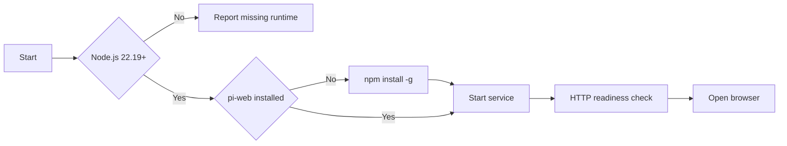

# Pi Web Tray

**English** | [简体中文](README.zh-CN.md)

Pi Web Tray is a Windows tray application for launching and managing
[pi-web](https://github.com/agegr/pi-web). It detects runtime dependencies, installs
pi-web through npm when required, starts the service, and opens the web interface.

The executable targets **.NET Framework 4.8** and has no third-party runtime
dependencies.



## Features

| Capability           | Description                                                                                                     |
| -------------------- | --------------------------------------------------------------------------------------------------------------- |
| Dependency detection | Detects Node.js, npm, pi-web and the pi CLI, including versions and paths.                                      |
| Installation         | Installs pi-web with `npm install -g` when it is missing or when the user requests an update.                   |
| Service management   | Starts, stops and restarts pi-web and reports the current state.                                                |
| Status reporting     | Uses tray icon colors, tooltips and notifications to report state and errors.                                   |
| Start at login       | Supports the current-user Run key or an on-logon scheduled task with administrative rights.                     |
| Diagnostics          | Provides an environment check, service log, install log, update log and diagnostic snapshot.                    |
| Updates              | Checks the latest GitHub release, verifies its SHA-256 checksum, replaces the application files and restarts.   |
| About                | Shows the application name, version, author and project link.                                                   |
| Localization         | Supports English, Simplified Chinese and Traditional Chinese; the default follows the Windows display language. |

## Compatibility

| Component                    | Requirement                                                                                 |
| ---------------------------- | ------------------------------------------------------------------------------------------- |
| Pi Web Tray                  | Windows 7 SP1, Windows 8.1, Windows 10 or Windows 11 with .NET Framework 4.8                |
| Recommended operating system | Windows 10 1809 or later                                                                    |
| Node.js                      | 22.19 or later                                                                              |
| npm                          | Included with Node.js                                                                       |
| Network                      | Access to an npm registry; `NpmRegistry` may point to a mirror. GitHub is used for updates. |

The tray binary is built for Windows 7 SP1, Windows 8.1, Windows 10 and Windows 11 and
uses Windows 7-compatible APIs. pi-web itself requires Node.js 22.19 or later and
`node-pty`; current Node.js releases may not support Windows 7 or 8.1, and the terminal
panel requires ConPTY (Windows 10 1809 or later). On such systems the tray may run while
the pi-web service is unavailable.

Windows 7 and Windows 8.1 are no longer supported by Microsoft. Use of these
systems is at the user's discretion.

## Related projects

Pi Web Tray is a launcher and installer for the following upstream projects. It does not
bundle or modify their source code.

| Project | Repository                                                | Role                                                                                          |
| ------- | --------------------------------------------------------- | --------------------------------------------------------------------------------------------- |
| pi-web  | [agegr/pi-web](https://github.com/agegr/pi-web)           | Web interface, installed from the npm package `@agegr/pi-web`.                                |
| pi      | [earendil-works/pi](https://github.com/earendil-works/pi) | Coding agent and CLI, installed from `@earendil-works/pi-coding-agent` when `InstallPiCli=1`. |

Report issues specific to pi-web or pi in their respective repositories.

## Installation

### Prebuilt release

1. Download and extract the release archive.
2. Keep `pi-web-tray.exe`, `pi-web-tray.exe.config` and the `zh-Hans` / `zh-Hant`
   resource folders in the same directory.
3. Run `pi-web-tray.exe`.

On first start the application checks the environment, installs missing
dependencies, starts the service and opens the browser. Configuration and logs
(`server.log`, `install.log`, `update.log`) are stored next to the executable, or in
`%LOCALAPPDATA%\pi-web-tray` when the executable is located in a protected directory such
as `Program Files`.

### Build from source

Requirements:

| Tool           | Requirement                                                               |
| -------------- | ------------------------------------------------------------------------- |
| Windows        | Windows 10 or 11 for building                                             |
| Visual Studio  | 2022 or 2026 with the .NET desktop development workload                   |
| .NET Framework | 4.8 targeting pack                                                        |
| .NET SDK       | Optional; version 8.0 or later with the .NET Framework 4.8 targeting pack |

```bat
git clone https://github.com/Arondight/pi-web-tray.git
cd pi-web-tray
build.cmd
```

Close any running `pi-web-tray.exe` before building. The build script does not terminate
running processes.

Build output:

```text
artifacts\pi-web-tray.exe
artifacts\pi-web-tray.exe.config
artifacts\zh-Hans\pi-web-tray.resources.dll
artifacts\zh-Hant\pi-web-tray.resources.dll
```

The solution includes a test project; building it restores MSTest packages. The application
itself has no NuGet dependencies.

Alternatively, open `PiWebTray.sln` in Visual Studio or run:

```powershell
dotnet build PiWebTray.sln -c Release
```

## Usage

### Tray states

| Color  | State                                                 |
| ------ | ----------------------------------------------------- |
| Green  | pi-web is running on `127.0.0.1:<port>`.              |
| Grey   | Prerequisites are available; the service is stopped.  |
| Orange | Checking, installing, starting, stopping or updating. |
| Blue   | Node.js or pi-web is missing.                         |
| Red    | An error occurred; see the service or install log.    |

### Tray menu

```text
Running - 127.0.0.1:30141 - admin mode
---------------------------------------
Open Pi Web
Start service
Stop service
Restart service
---------------------------------------
Install / update dependencies
Check for updates
Download Node.js...
Environment check
View service log
View install log
Open install folder
Create desktop shortcut
---------------------------------------
Start at login: on (normal permissions)
Start at login as admin: no
---------------------------------------
About
Exit (stop pi-web)
```

### Behavior

- Left-clicking the icon starts pi-web and opens the browser, or only opens the
  browser when the service is already running.
- Selecting "Run as administrator" transfers control to an elevated tray instance and
  runs pi-web with administrative rights.
- Only one tray instance and one pi-web service can run at a time.
- Start at login uses either `HKCU\...\Run` or an on-logon scheduled task. The two modes
  are mutually exclusive.
- **Check for updates** downloads the latest GitHub release, verifies its SHA-256
  checksum, stops pi-web, replaces the application files and restarts the tray. If the
  installation directory needs administrator rights, Windows shows a UAC prompt. The
  configuration file, logs and the pi-web installation are left untouched.

The **Environment check** menu item opens two tables: **Runtime components** (component,
version, path and status) and **Application information** (configuration, port, directories
and logs).

Before the first conversation, authenticate a model provider in the **Models** panel
or run `pi auth login`; pi-web and pi share credentials in `~/.pi/agent`.

## Configuration

The configuration file is `pi-web-tray.ini`. It is generated on first start.

| Executable location                          | Configuration and logs       |
| -------------------------------------------- | ---------------------------- |
| Normal directory                             | Next to the executable       |
| Protected directory, such as `Program Files` | `%LOCALAPPDATA%\pi-web-tray` |

| Key              | Default         | Description                                                                     |
| ---------------- | --------------- | ------------------------------------------------------------------------------- |
| `Port`           | `30141`         | pi-web listening port.                                                          |
| `WorkingDir`     | `%USERPROFILE%` | Service working directory, used as pi's default project directory.              |
| `AutoInstall`    | `1`             | Install pi-web automatically when missing. `0` disables automatic installation. |
| `InstallPiCli`   | `1`             | Install the pi command-line tool together with pi-web.                          |
| `InstallTag`     | `latest`        | npm distribution tag or exact version.                                          |
| `NpmRegistry`    | empty           | Custom npm registry, for example `https://registry.npmmirror.com`.              |
| `NodePath`       | empty           | Explicit path to `node.exe`; empty enables auto-detection.                      |
| `ServerScript`   | empty           | Explicit path to `pi-web.js`; empty enables auto-detection.                     |
| `Language`       | `auto`          | UI language: `auto`, `en`, `zh` (Simplified) or `zh-Hant` (Traditional).        |
| `AutostartAdmin` | `0`             | Whether start at login uses administrative rights. Maintained by the tray menu. |

Example:

```ini
Port=30141
WorkingDir=%USERPROFILE%
AutoInstall=1
InstallPiCli=1
InstallTag=latest
NpmRegistry=
NodePath=
ServerScript=
AutostartAdmin=0
Language=auto
```

Comments begin with `;` or `#` when preceded by whitespace. Values containing these
characters may be quoted. `%ENV%` variables are expanded.

Environment variables:

| Variable                     | Description                                                 |
| ---------------------------- | ----------------------------------------------------------- |
| `PI_WEB_TRAY_PORT`           | Overrides the configured port.                              |
| `PI_WEB_TRAY_LANG`           | Overrides the UI language: `auto`, `en`, `zh` or `zh-Hant`. |
| `PI_WEB_TRAY_HOME`           | Overrides the data directory.                               |
| `HTTP_PROXY` / `HTTPS_PROXY` | Used by npm and pi-web model requests.                      |

## Command line

```text
pi-web-tray.exe              Start pi-web and open the browser.
pi-web-tray.exe --stop       Stop the service and keep the tray running.
pi-web-tray.exe --quit       Stop the service and exit the tray.
pi-web-tray.exe --check      Check the environment; 0 = ready, 1 = something missing.
pi-web-tray.exe --install    Install dependencies without starting the tray.
pi-web-tray.exe --dry-run    With --install, print the npm command only.
pi-web-tray.exe --diag       Write a diagnostic snapshot to diag.txt.
pi-web-tray.exe --version    Print the version.
pi-web-tray.exe --help       Show command-line help.
```

Unknown arguments return exit code 2.

## Localization

The application includes English, Simplified Chinese and Traditional Chinese text. The
default language follows the Windows display language.

```ini
Language=auto     ; auto / en / zh / zh-Hant
```

```powershell
$env:PI_WEB_TRAY_LANG='en'
```

Text is stored in `src/Resources/Strings.resx` (neutral English),
`src/Resources/Strings.zh-Hans.resx` (Simplified Chinese) and
`src/Resources/Strings.zh-Hant.resx` (Traditional Chinese). The build generates the
corresponding satellite assemblies; additional cultures can be added with a new
`Strings.<culture>.resx` file. The setting applies to the tray menu, tooltips, notifications,
command-line output and the generated configuration comments.

## Troubleshooting

| Symptom                                       | Action                                                                                                                                    |
| --------------------------------------------- | ----------------------------------------------------------------------------------------------------------------------------------------- |
| Blue icon; Node.js required                   | Install Node.js 22.19 or later and click the tray icon. Set `NodePath` if auto-detection fails.                                           |
| Installation failed                           | Check the end of `install.log`. Common causes are an unwritable npm global directory, an invalid `InstallTag`, or network/proxy problems. |
| Update failed                                 | Check `update.log`. A cancelled UAC prompt and network/proxy problems are the most common causes; rerun **Check for updates** afterwards. |
| Red icon; service failed                      | Check `server.log`. `EADDRINUSE` indicates a port conflict; `Cannot find module` usually indicates an incomplete installation.            |
| Terminal panel reports `Cannot launch conpty` | ConPTY is unavailable on Windows 7 and 8.1. Chat and tool calls remain available where Node.js runs.                                      |
| Models panel is empty                         | Authenticate in the Models panel or run `pi auth login`.                                                                                  |
| Start at login does not work                  | Check the state in the tray menu, then verify `HKCU\...\Run` or `schtasks /query /tn PiWebTray`.                                          |
| Additional diagnostics required               | Run `pi-web-tray.exe --diag`; the output is written to `diag.txt` in the configuration directory.                                         |
| Tray application crashed                      | Check `%LOCALAPPDATA%\pi-web-tray\crash.log`.                                                                                             |
| Application does not start on Windows 7       | Install .NET Framework 4.8 and keep `pi-web-tray.exe.config` next to the executable.                                                      |

## Uninstallation

1. Select **Exit (stop pi-web)** from the tray menu.
2. Disable **Start at login** before deleting the executable.
3. Delete the directory containing the executable and configuration file.
4. Optionally delete `%LOCALAPPDATA%\pi-web-tray`.
5. Optionally remove the npm packages:

   ```powershell
   npm uninstall -g @agegr/pi-web
   npm uninstall -g @earendil-works/pi-coding-agent
   ```

## Security

- The application runs with the current user token by default (`asInvoker`). Elevation
  occurs only when explicitly requested.
- The application does not modify the global npm configuration or request credentials.
- The application contains no telemetry or network listener. Update checks are only made
  when the user selects **Check for updates**; the release archive is downloaded over HTTPS
  from GitHub and verified against the SHA-256 file published with the release.
- `NodePath`, `ServerScript`, `WorkingDir`, `NpmRegistry` and `InstallTag` are trusted
  configuration values. Do not point them at untrusted paths or registries.
- Report vulnerabilities according to [SECURITY.md](SECURITY.md).

## Limitations

- The application is Windows-only.
- On Windows 7 and 8.1, the tray is compatible, but pi-web's terminal requires ConPTY
  and Node.js 22.19 or later may not support those systems.
- npm 12 blocks dependency install scripts by default. The pi-web install step passes a
  one-off `--allow-scripts` allowlist (the existing npm entries plus `@agegr/pi-web` and
  `node-pty`), while the pi CLI is installed with `--ignore-scripts` as its documentation
  recommends. The application re-checks the installation and reports failures; it does not
  modify the npm configuration.
- Node.js is not installed automatically.
- A listener already using the configured port is treated as a running pi-web service.
  Change `Port` if the port is occupied by another program.
- Updates require access to the GitHub API and release assets. Updating an installation in
  a protected directory requires administrator rights; the restarted tray may run elevated
  if a de-elevated restart cannot be confirmed.
- Unsigned releases may trigger SmartScreen on first execution.

## Contributing

Bug reports, translations and pull requests are accepted. Read
[CONTRIBUTING.md](CONTRIBUTING.md) and [CODE_OF_CONDUCT.md](CODE_OF_CONDUCT.md) before
contributing. Report security issues according to [SECURITY.md](SECURITY.md).

## License

[MIT](LICENSE)
