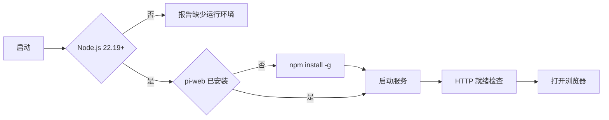

# Pi Web Tray

[English](README.md) | **简体中文**

Pi Web Tray 是一个用于启动和管理 [pi-web](https://github.com/agegr/pi-web) 的 Windows
托盘程序。程序检测运行依赖，在需要时通过 npm 安装 pi-web，启动服务并打开 Web 界面。

可执行文件基于 **.NET Framework 4.8** 构建，不包含第三方运行时依赖。



## 功能

| 功能       | 说明                                                                  |
| ---------- | --------------------------------------------------------------------- |
| 依赖检测   | 检测 Node.js、npm、pi-web 和 pi CLI 的路径与版本。                    |
| 依赖安装   | 缺少 pi-web 或用户请求更新时，执行 `npm install -g`。                 |
| 服务管理   | 启动、停止和重启 pi-web，并报告当前状态。                             |
| 状态显示   | 通过托盘图标颜色、工具提示和通知报告状态与错误。                      |
| 开机自启动 | 启动托盘和 pi-web（不打开浏览器），支持 Run 注册表项或登录计划任务。  |
| 诊断       | 提供环境检查、可暂停/筛选的实时日志、更新日志、数据目录和诊断快照。   |
| 更新       | 检查 GitHub、校验 SHA-256、替换文件并重启；保留运行状态并清理旧文件。 |
| 设置       | 在可调整大小、可滚动的窗口中修改端口、目录、语言、依赖和更新选项。    |
| 进度       | 显示安装/更新进度；安装和更新下载支持取消。                           |
| 安全       | 使用原生进程 API 检测端口冲突，不会杀掉占用端口的无关进程。           |
| 关于       | 显示软件名称、版本、作者和项目链接。                                  |
| 本地化     | 支持英文、简体中文和繁体中文；默认跟随 Windows 显示语言。             |

## 兼容性

| 组件         | 要求                                                                 |
| ------------ | -------------------------------------------------------------------- |
| Pi Web Tray  | Windows 7 SP1、Windows 8、8.1、10 或 11，且安装 .NET Framework 4.8   |
| 推荐操作系统 | Windows 10 1809 或更新版本                                           |
| Node.js      | 22.19 或更新版本                                                     |
| npm          | 随 Node.js 安装                                                      |
| 网络         | 可访问 npm registry；`NpmRegistry` 可指向镜像；更新时需访问 GitHub。 |

托盘程序面向 Windows 7 SP1、Windows 8、8.1、10 和 11 构建，并使用
Windows 7 可用的 API。pi-web 本身要求 Node.js 22.19 或更新版本及 `node-pty`；
当前 Node.js 版本可能不支持 Windows 7 或 8，终端面板还需要 ConPTY
（Windows 10 1809 或更新版本）。在上述旧系统上托盘可以运行，但 pi-web 服务可能不可用。

Windows 7 和 Windows 8.1 已停止微软支持，使用风险由用户自行承担。
在 Windows 7 和 Windows 8 上，**下载 Node.js** 会在确认后打开一个未签名的社区构建；
本项目不生产也不验证该构建。

## 相关项目

Pi Web Tray 只负责启动和安装以下上游项目，不包含也不修改它们的源代码。

| 项目   | GitHub                                                    | 作用                                                                          |
| ------ | --------------------------------------------------------- | ----------------------------------------------------------------------------- |
| pi-web | [agegr/pi-web](https://github.com/agegr/pi-web)           | Web 界面，npm 包为 `@agegr/pi-web`。                                          |
| pi     | [earendil-works/pi](https://github.com/earendil-works/pi) | 编程代理和命令行，`InstallPiCli=1` 时安装 `@earendil-works/pi-coding-agent`。 |

pi-web 或 pi 本身的问题请提交到各自仓库。

## 安装

### 使用发布包

1. 下载并解压发布包。
2. 将 `pi-web-tray.exe`、`pi-web-tray.exe.config`、`pi-web-tray.files.txt` 和
   `zh-Hans` / `zh-Hant` 资源目录放在同一目录。
3. 运行 `pi-web-tray.exe`。

`pi-web-tray.files.txt` 清单用于后续更新清理新版本中已移除的程序文件，请勿删除；配置和
日志不会写入该清单。

首次启动时，程序检查运行环境、安装缺失依赖、启动服务并打开浏览器。配置文件与日志
（`server.log`、`install.log`、`update.log`）默认位于可执行文件同目录；当可执行文件
位于 `Program Files` 等受保护目录时，位于 `%LOCALAPPDATA%\pi-web-tray`。

### 从源码构建

构建环境：

| 工具           | 要求                                                           |
| -------------- | -------------------------------------------------------------- |
| Windows        | Windows 10 或 11                                               |
| Visual Studio  | 2022 或 2026，安装 .NET 桌面开发工作负载                       |
| .NET Framework | 4.8 targeting pack                                             |
| .NET SDK       | 可选；8.0 或更新版本，并安装 .NET Framework 4.8 targeting pack |

```bat
git clone https://github.com/Arondight/pi-web-tray.git
cd pi-web-tray
build.cmd
```

构建前请先退出正在运行的 `pi-web-tray.exe`。构建脚本不会自动结束正在运行的进程。

构建输出：

```text
artifacts\pi-web-tray.exe
artifacts\pi-web-tray.exe.config
artifacts\zh-Hans\pi-web-tray.resources.dll
artifacts\zh-Hant\pi-web-tray.resources.dll
```

解决方案包含测试项目，构建时会还原 MSTest 包；应用程序本身没有 NuGet 依赖。
`scripts\package-release.ps1` 会把 `pi-web-tray.files.txt` 清单加入发布包。

也可以使用 Visual Studio 打开 `PiWebTray.sln`，或执行：

```powershell
dotnet build PiWebTray.sln -c Release
```

## 使用

### 托盘状态

| 颜色 | 状态                                    |
| ---- | --------------------------------------- |
| 绿色 | pi-web 正在 `127.0.0.1:<端口>` 上运行。 |
| 灰色 | 运行环境已就绪，服务已停止。            |
| 橙色 | 正在检查、安装、启动、停止或更新。      |
| 蓝色 | 缺少 Node.js 或 pi-web。                |
| 红色 | 发生错误，请查看服务日志或安装日志。    |

### 托盘菜单

```text
运行中 - 127.0.0.1:30141 - 管理员模式
---------------------------------------
打开 Pi Web
启动服务
停止服务
重启服务
---------------------------------------
更新 pi-web / pi 依赖
更新 Pi Web Tray
下载 Node.js...
---------------------------------------
环境自检
设置...
日志 > 服务 / 安装 / 更新
打开数据目录
打开程序目录
打开配置文件
复制 Pi Web 地址
创建桌面快捷方式
---------------------------------------
开机自启动：已开启（普通权限）
自启动时使用管理员权限：否
---------------------------------------
以管理员身份重启
关于
退出（并停止 pi-web）
```

### 行为说明

- 左键单击托盘图标：服务未运行时启动服务并打开浏览器；服务已运行时仅打开浏览器。
- **启动服务** 和 **重启服务** 不会打开浏览器；只有 **打开 Pi Web** 和左键单击图标会打开。
- 选择 **以管理员身份重启** 后，由管理员权限的托盘实例接管，并以管理员权限运行 pi-web。
- 同一时间只允许一个托盘实例和一个 pi-web 服务运行。
- 开机自启动使用 `HKCU\...\Run` 或登录计划任务，两种模式互斥。登录后托盘和 pi-web
  会启动，但不打开浏览器；管理员模式要求当前账户本身是管理员。
- **更新 pi-web / pi 依赖** 会先停止 pi-web（npm 无法替换正在运行的程序包），再安装或更新
  npm 包；强制重装前会确认，并显示带取消按钮的进度窗口。仅当 `InstallPiCli=1` 时才会
  更新 pi。如果 pi-web 之前在运行，更新完成后会在不打开浏览器的情况下重新启动。
- **更新 Pi Web Tray** 会下载 GitHub 最新 release、校验 SHA-256、停止 pi-web、替换程序
  文件并重启托盘。更新会保留 pi-web 原来是否运行，不打开新浏览器标签。新版本中已移除、
  但存在于上一版本清单中的程序文件会被清理；配置、日志和 pi-web 数据不会写入清单，因此
  不受影响。清理需要上一版本安装留下的清单；早于清单功能的版本在首次升级时无法清理文件。
  若安装目录需要管理员权限，Windows 会显示 UAC 提示。取消会立即中止正在进行的
  HTTP 请求，而不只是关闭界面状态。
- **设置** 在可调整大小、可滚动的窗口中修改支持的 ini 配置，适配小屏幕和高 DPI；
  **日志** 打开支持暂停/继续、文本筛选并保持滚动位置的实时窗口，而不是 Notepad 快照。
- 如果监听端口的不是 pi-web，托盘会报告 **端口冲突**。托盘使用原生 Toolhelp/PEB API
  而不是 WMI 识别进程所有者，因此 WMI 服务被禁用时仍可工作；不会视为运行中，也不会停止
  或杀掉无关进程；请在设置中修改端口。
- pi-web 意外退出时会通知用户；`AutoRestart=1` 时可自动重启。如果在检查或下载更新期间
  意外停止，重启会推迟到更新操作结束后执行。`AutoCheckUpdates=1` 会在启动后检查新版本，
  并在菜单中标记可用更新。

菜单中的 **环境自检** 打开两个表格：**运行组件**（组件、版本、路径、状态）和
**应用信息**（配置、端口、目录、日志）。

首次对话前，需要在 **Models** 面板中登录模型提供方，或在命令行执行
`pi auth login`。pi-web 与 pi 共用 `~/.pi/agent` 中的凭据。

## 配置

配置文件为 `pi-web-tray.ini`，首次启动时自动生成。

| 可执行文件位置               | 配置与日志位置               |
| ---------------------------- | ---------------------------- |
| 普通目录                     | 可执行文件同目录             |
| `Program Files` 等受保护目录 | `%LOCALAPPDATA%\pi-web-tray` |

| 键                 | 默认值          | 说明                                                       |
| ------------------ | --------------- | ---------------------------------------------------------- |
| `Port`             | `30141`         | pi-web 监听端口。                                          |
| `WorkingDir`       | `%USERPROFILE%` | 服务工作目录，同时作为 pi 的默认项目目录。                 |
| `AutoInstall`      | `1`             | 缺少 pi-web 时自动安装；`0` 表示仅手动安装。               |
| `AutoRestart`      | `0`             | pi-web 意外停止后自动重启。                                |
| `AutoCheckUpdates` | `0`             | 启动后检查 Pi Web Tray 新版本。                            |
| `InstallPiCli`     | `1`             | 安装 pi-web 时同时安装 pi 命令行工具。                     |
| `InstallTag`       | `latest`        | npm 分发标签或具体版本号。                                 |
| `NpmRegistry`      | 空              | 自定义 npm 源，例如 `https://registry.npmmirror.com`。     |
| `NodePath`         | 空              | 指定 `node.exe` 路径；留空时自动检测。                     |
| `ServerScript`     | 空              | 指定 `pi-web.js` 路径；留空时自动检测。                    |
| `Language`         | `auto`          | 界面语言：`auto`、`en`、`zh`（简体）或 `zh-Hant`（繁体）。 |
| `AutostartAdmin`   | `0`             | 开机自启动是否使用管理员权限，由托盘菜单维护。             |

配置示例：

```ini
Port=30141
WorkingDir=%USERPROFILE%
AutoInstall=1
AutoRestart=0
AutoCheckUpdates=0
InstallPiCli=1
InstallTag=latest
NpmRegistry=
NodePath=
ServerScript=
AutostartAdmin=0
Language=auto
```

注释以 `;` 或 `#` 开头，且注释符号前需要有空白。值中包含这些字符时，可以使用引号
包裹。`%ENV%` 环境变量会被展开。

环境变量：

| 变量                         | 说明                                            |
| ---------------------------- | ----------------------------------------------- |
| `PI_WEB_TRAY_PORT`           | 覆盖配置文件中的端口。                          |
| `PI_WEB_TRAY_LANG`           | 覆盖界面语言：`auto`、`en`、`zh` 或 `zh-Hant`。 |
| `PI_WEB_TRAY_HOME`           | 覆盖数据目录。                                  |
| `HTTP_PROXY` / `HTTPS_PROXY` | 供 npm 和 pi-web 的模型请求使用。               |

## 命令行

```text
pi-web-tray.exe              启动 pi-web 并打开浏览器。
pi-web-tray.exe --autostart  启动托盘和 pi-web，但不打开浏览器。
pi-web-tray.exe --tray-only  仅启动托盘，不启动 pi-web。
pi-web-tray.exe --start-no-open  启动 pi-web，但不打开浏览器。
pi-web-tray.exe --stop       停止服务，保留托盘。
pi-web-tray.exe --quit       停止服务并退出托盘。
pi-web-tray.exe --check      检查运行环境；0 = 就绪，1 = 缺少组件。
pi-web-tray.exe --install    仅安装依赖，不启动托盘。
pi-web-tray.exe --dry-run    与 --install 配合使用，仅打印 npm 命令。
pi-web-tray.exe --diag       将诊断快照写入 diag.txt。
pi-web-tray.exe --version    显示版本。
pi-web-tray.exe --help       显示命令行帮助。
```

未知参数返回退出码 2。

## 本地化

程序内置英文、简体中文和繁体中文，默认跟随 Windows 显示语言。

```ini
Language=auto     ; auto / en / zh / zh-Hant
```

```powershell
$env:PI_WEB_TRAY_LANG='en'
```

文案存放在 `src/Resources/Strings.resx`（英文中性资源）、
`src/Resources/Strings.zh-Hans.resx`（简体中文）和
`src/Resources/Strings.zh-Hant.resx`（繁体中文）。构建时会生成对应的附属程序集；
新增语言只需添加 `Strings.<culture>.resx` 文件。该设置影响托盘菜单、工具提示、
通知、命令行输出和生成的配置注释。

## 故障排查

| 现象                                | 处理方法                                                                                         |
| ----------------------------------- | ------------------------------------------------------------------------------------------------ |
| 蓝色图标，提示需要 Node.js          | 安装 Node.js 22.19 或更新版本，然后点击托盘图标。自动检测失败时设置 `NodePath`。                 |
| 安装失败                            | 查看 `install.log` 末尾。常见原因包括 npm 全局目录不可写、`InstallTag` 无效或网络/代理问题。     |
| 更新失败                            | 查看 `update.log`。常见原因是取消 UAC 提示或网络/代理问题；之后可重新执行 **更新 Pi Web Tray**。 |
| 红色图标，端口冲突                  | 其他程序占用了配置端口。打开 **设置** 选择空闲端口；托盘不会杀掉该进程。                         |
| 红色图标，服务失败                  | 查看 `server.log`。`EADDRINUSE` 表示端口冲突；`Cannot find module` 通常表示安装不完整。          |
| 找不到设置、日志或配置              | 使用 **设置**、**打开数据目录**、**打开配置文件** 或 **日志** 子菜单。                           |
| 终端面板提示 `Cannot launch conpty` | Windows 7 和 8.1 不支持 ConPTY。Node.js 可用的环境下，聊天和工具调用仍可使用。                   |
| Models 面板为空                     | 在 Models 面板中登录，或执行 `pi auth login`。                                                   |
| 开机自启动无效                      | 检查托盘菜单中的状态，然后检查 `HKCU\...\Run` 或 `schtasks /query /tn PiWebTray`。               |
| 需要更多诊断信息                    | 执行 `pi-web-tray.exe --diag`，输出写入配置目录下的 `diag.txt`。                                 |
| 托盘程序崩溃                        | 查看 `%LOCALAPPDATA%\pi-web-tray\crash.log`。                                                    |
| Windows 7 无法启动                  | 安装 .NET Framework 4.8，并确认 `pi-web-tray.exe.config` 与可执行文件位于同一目录。              |

## 卸载

1. 在托盘菜单中选择 **退出（并停止 pi-web）**。
2. 删除可执行文件前，先关闭 **开机自启动**。
3. 删除包含可执行文件和配置文件的目录。
4. 可选：删除 `%LOCALAPPDATA%\pi-web-tray`。
5. 可选：卸载 npm 包：

   ```powershell
   npm uninstall -g @agegr/pi-web
   npm uninstall -g @earendil-works/pi-coding-agent
   ```

## 安全

- 默认以当前用户令牌运行（`asInvoker`），仅在用户明确请求时提权。
- 不修改全局 npm 配置，不请求凭据。
- 不包含遥测或网络监听功能。仅在用户选择 **更新 Pi Web Tray** 或启用
  `AutoCheckUpdates=1` 时访问 GitHub；发布包通过 HTTPS 下载，并使用随 release 发布的
  SHA-256 文件校验。更新助手还会校验目标安装和暂存文件指纹。仍建议通过代码签名进一步
  验证发布者。
- `NodePath`、`ServerScript`、`WorkingDir`、`NpmRegistry` 和 `InstallTag` 属于受信任
  配置。不要将其指向不可信路径或源。
- 安全问题请按照 [SECURITY.md](SECURITY.md) 报告。

## 限制

- 仅支持 Windows。
- 在 Windows 7 和 8.1 上，托盘程序兼容，但 pi-web 终端需要 ConPTY，且 Node.js
  22.19 或更新版本可能不支持这些系统。
- npm 12 默认阻止依赖的 install 脚本。安装 pi-web 时会一次性传入
  `--allow-scripts`（保留已有的 npm 条目，并加入 `@agegr/pi-web` 和 `node-pty`），
  pi CLI 则按其文档使用 `--ignore-scripts`。程序会重新检查安装结果并报告失败，
  不会修改 npm 配置。
- 不会自动安装 Node.js。
- 无法识别为 pi-web 的监听端口会报告为端口冲突，程序不会停止或杀掉该进程；请在
  **设置** 中修改 `Port`。
- 管理员权限的开机自启动要求当前账户本身是管理员；标准用户请使用普通权限自启动。
  管理员计划任务是整机范围的，请只在一个账户中配置。
- 更新需要访问 GitHub API 和发布资源。更新受保护目录中的安装需要管理员权限；更新后
  会保留 pi-web 原来的运行状态。如果无法确认已降权重启，重启后的托盘可能以管理员权限
  运行。
- 如果托盘以管理员权限运行，请在管理员命令行中执行 `--stop` / `--quit`；托盘菜单始终可用。
- 未签名的发布包首次执行时可能触发 SmartScreen。

## 参与贡献

接受 Bug 报告、翻译和 Pull Request。参与前请阅读 [CONTRIBUTING.md](CONTRIBUTING.md)
和 [CODE_OF_CONDUCT.md](CODE_OF_CONDUCT.md)。安全问题请按照 [SECURITY.md](SECURITY.md)
报告。

## 许可证

[MIT](LICENSE)
